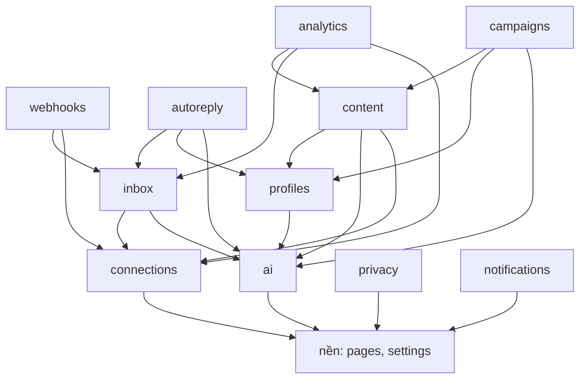
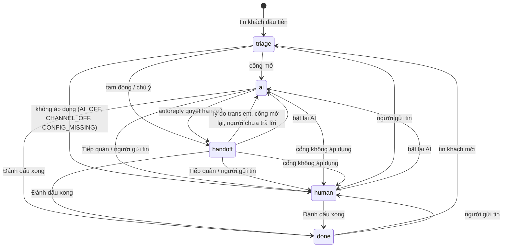
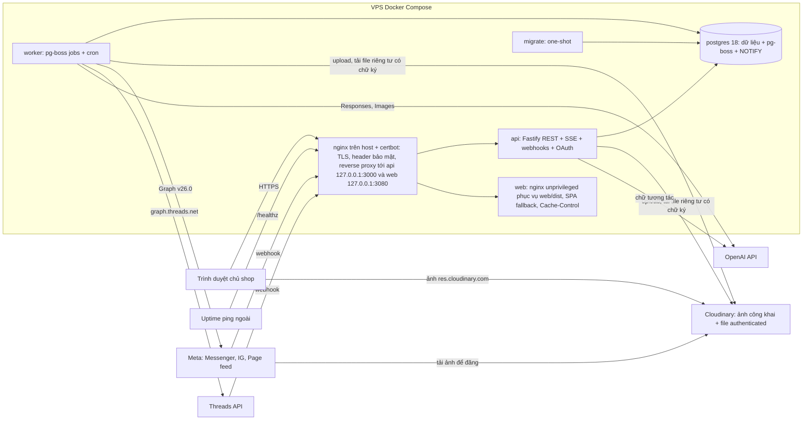
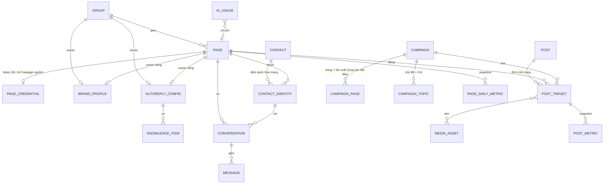

# Architecture Spine — OnTheTopMoney Backend

`F1`…`F7` là Key Flow 1–7 trong `EXPERIENCE.md`. Thuật ngữ dùng đúng bảng Thuật ngữ của EXPERIENCE.md; tên trong code: Trang=`page`, Nhóm=`group`, Phạm vi=`scope`, Hồ sơ thương hiệu=`brand profile`, Cấu hình AI=`autoreply config`, Chuyển cho bạn=`handoff`, Tiếp quản=`takeover`.

## Design Paradigm

**Modular monolith theo ports-and-adapters.** Một codebase TypeScript, hai entrypoint:

- `api`: HTTP REST + SSE + nhận webhook + OAuth callback. Không chạy việc nền dài.
- `worker`: consumer pg-boss (job, cron, sự kiện). Mọi tác dụng phụ ra Meta chạy ở đây.

Postgres là nguồn sự thật duy nhất: dữ liệu, hàng đợi (pg-boss), kênh realtime (LISTEN/NOTIFY). Không Redis.

| Lớp | Thư mục | Được làm |
|---|---|---|
| Entrypoint | `server/src/app/`, `server/src/worker/` | Ghép route/consumer, auth; được import mọi module |
| Read model | `server/src/app/read-models/` | Ghép DTO xuyên module cho route; chỉ gọi hàm đọc từ `index.ts`; không ghi |
| Module | `server/src/modules/<module>/` | Nghiệp vụ, sở hữu bảng của mình, public API qua `index.ts` |
| Adapter | `server/src/adapters/{meta,openai,media,crypto}/` | Nói chuyện với hệ ngoài; không biết nghiệp vụ |
| Nền tảng | `server/src/platform/{db,jobs,events,realtime,config,log}/` | Hạ tầng dùng chung |
| Hợp đồng chung | `packages/shared/` | zod schema, enum, `ErrorCode`, danh mục sự kiện, bảng ràng buộc nền tảng — dùng cho cả `server` và `web` |

## Invariants & Rules

### Ranh giới và phụ thuộc



Entrypoint và `read-models` được import mọi module. Module nào cũng được gọi `pages`, `settings` và các adapter/platform. `pages`, `settings` không gọi module nào. `notifications` và `privacy` chỉ được entrypoint gọi; các module khác báo cho chúng qua sự kiện.

### AD-1 — Module sở hữu bảng, gọi nhau qua `index.ts`

- **Binds:** all
- **Prevents:** hai module cùng ghi một bảng; đọc SQL chéo module; vòng phụ thuộc.
- **Rule:** Mỗi bảng thuộc đúng một module (bảng ở Structural Seed). Module khác chỉ đọc/ghi qua hàm export từ `modules/<m>/index.ts`; không query bảng của module khác, kể cả bằng SQL thô. Mũi tên chỉ theo sơ đồ trên. Báo ngược chiều chỉ qua sự kiện (AD-3). Thực thi trong CI bằng `dependency-cruiser` (parser không cần API của TypeScript, vì TS 7 không có API cho typescript-eslint) với danh sách cho phép sinh từ đúng bảng mũi tên này, cộng `no-circular` và cấm import `modules/*/` ngoài `index.ts`; nếu spike cho thấy không chạy được thì dùng oxlint `no-restricted-imports` sinh từ cùng bảng.

### AD-2 — Tác dụng phụ ra ngoài chạy bằng job

- **Binds:** inbox, content, campaigns, analytics, connections, autoreply, privacy
- **Prevents:** request HTTP gửi tin/đăng bài trực tiếp rồi mất khi lỗi; hai nơi gửi cùng một tin.
- **Rule:** Gửi tin, đăng bài, sinh ảnh, trích văn bản file, kéo số liệu, làm mới token, đăng ký webhook trang, xoá dữ liệu: api ghi bản ghi trạng thái rồi enqueue job pg-boss trong **cùng transaction** (tùy chọn `db` executor của pg-boss). Worker thực thi, cập nhật trạng thái, phát sự kiện. Ngoại lệ duy nhất: sinh chữ tương tác (Tạo bằng AI, Gợi ý bằng AI, Thử AI, Viết thử bằng AI, Tạo lại caption) chạy trong request api qua AI gateway (AD-7), trả JSON một lần; nút "Dừng" = client huỷ request, server truyền `AbortSignal` sang OpenAI. "Lấy từ Hồ sơ thương hiệu" và "Mẫu theo ngành" là template xác định phía server, không gọi AI.

### AD-3 — Sự kiện miền và realtime

- **Binds:** all, `web/` Hộp thư, Tổng quan, Lịch nội dung, Chiến dịch
- **Prevents:** mỗi module tự chế kênh thông báo hoặc payload; quên NOTIFY; client hiển thị payload lệch với REST.
- **Rule:** `packages/shared/events.ts` khai báo mỗi sự kiện kèm zod payload và cờ `realtime`. Tên `<entity>.<pastVerb>`. Payload luôn có `id`, `pageId` (nếu có) và mọi khoá consumer đã biết cần (vd `post_target.failed` có `campaignId`, `errorCode`; `conversation.state_changed` có `from`, `to`, `reasonCode`). Danh mục khởi điểm: `conversation.state_changed`, `message.received`, `message.sent`, `message.failed`, `post_target.published|failed|cancelled`, `campaign.paused|resumed|completed`, `page.connected|reconnected|disconnected|expiring|removed|group_changed`, `group.deleted`, `media_asset.created`, `knowledge_item.processed`, `ai_budget.threshold_reached|restored`, `openai_key.invalidated`, `settings.updated`, `webhook.stalled|recovered`, `job.failed`, `privacy.purge_requested|purge_part_completed|purge_completed`. Phát bằng pg-boss `publish` trong cùng transaction với thay đổi trạng thái. Consumer idempotent theo `(event, id, version)`. Chỉ `platform/realtime` (một subscriber chung) chuyển sự kiện `realtime=true` thành `NOTIFY realtime` với payload `{type, entity, id, pageId}` ≤1 KB; module không tự `NOTIFY`, trừ sự kiện tạm `conversation.ai_typing`. api giữ một luồng SSE `GET /api/v1/stream` (heartbeat 25 giây; reverse proxy nginx tắt đệm cho luồng này: `proxy_buffering off`). Client chỉ dùng sự kiện để vô hiệu hoá cache và refetch qua REST; mất kết nối → tự nối lại và refetch danh sách đang mở. Client mở `EventSource` với `withCredentials: true` theo origin api lúc build (`VITE_API_ORIGIN`; trống = cùng origin); api gộp header CORS vào `writeHead` của luồng SSE (spec 1.3c).

### AD-4 — Cổng nhận webhook

- **Binds:** webhooks, F2, F7, Cài đặt › Webhook, State "Webhook ngừng nhận tin"
- **Prevents:** xử lý nghiệp vụ trong request webhook; xác minh chữ ký trên body đã parse; xử lý trùng khi Meta gửi lại theo cách gom khác; mỗi builder tự hiểu các loại sự kiện.
- **Rule:**
  - `POST /webhooks/meta` (Messenger, Instagram, Page feed) và `POST /webhooks/threads`: xác minh `X-Hub-Signature-256` = HMAC-SHA256 trên **raw body** với app secret của đúng app (Threads: Threads app secret [ASSUMPTION], tài liệu Meta chưa nói rõ; story webhook Threads xác nhận bằng sự kiện thật), so sánh constant-time; sai → 401, không ghi. Tách body thành từng mục (Graph: `entry[].messaging[]`, `entry[].changes[]`; Threads có dạng payload riêng, parser riêng), mỗi mục một dòng `webhook_events` với khoá chống trùng của mục (`mid`/`comment_id`/id media nếu có, ngược lại hash của mục), enqueue một `webhook.route` mỗi mục, trả 200. `GET` tương ứng trả `hub.challenge` khi verify token khớp.
  - `webhook.route` chuẩn hoá qua `adapters/meta` rồi ánh xạ: tin/bình luận/trả lời mới → `inbox.ingest`; sửa → `inbox.updateMessageText`; xoá/ẩn → `inbox.markMessageRemoved`; đã gửi/đã đọc → cập nhật trạng thái tin outbound; reaction, postback, loại khác → chỉ lưu. Trang không có trong DB hoặc đã gỡ → lưu, không route. Sự kiện thử (nút "Gửi sự kiện thử") mang cờ `test`, chỉ ghi nhật ký.
  - `webhook_events.status` ∈ `received|routed|ignored|failed` + `error_code`, hiển thị ở nhật ký Cài đặt; "Xử lý lại" enqueue lại mục `failed`.
  - Cron 5 phút tính `webhook_health` riêng cho `meta` và `threads`: `waiting_first` (chưa từng nhận) · `ok` · `stalled` (không có sự kiện >30 phút trong khung 08:00–22:00 giờ VN [ASSUMPTION], chỉ khi sản phẩm đó có trang `active`); đổi trạng thái → `webhook.stalled|recovered`.
  - Đăng ký webhook cấp app (callback URL, field) là bước triển khai một lần, ghi trong runbook; đăng ký cấp trang (`subscribed_apps`) là job `connections.subscribe_page` khi kết nối trang. Field tối thiểu: Page `messages`, `messaging_postbacks`, `message_echoes`, `feed`; Instagram `messages`, `comments`; Threads `replies`.

### AD-5 — `connections` là chủ duy nhất của token và trạng thái kết nối

- **Binds:** connections, pages, mọi module gọi Meta, F1 b1, F7, State "Token sắp hết hạn", "Mất kết nối", "Kết nối bị huỷ / thiếu quyền"
- **Prevents:** module tự giữ/cache token cũ; hai bản ghi trạng thái kết nối; FB và IG liên kết lệch trạng thái.
- **Rule:**
  - IG Business kết nối qua Facebook Login for Business (cùng luồng Fanpage); Threads qua OAuth Threads riêng.
  - Token lưu mã hoá (AD-12) trong `page_credentials` kèm `expires_at` (0 = không hết hạn, thường gặp với Page token), `data_access_expires_at` (hết hạn chủ yếu chặn quyền Instagram), `granular_scopes` (quyền theo từng trang, từ `debug_token`). Kết nối lại dùng `auth_type=reauthorize`. Trang IG không giữ token: `token_source_page_id` trỏ tới Fanpage liên kết; `getAccessToken(igPageId)` trả token của nguồn. Module khác lấy token bằng `connections.getAccessToken(pageId)` ngay trước mỗi lời gọi, không cache.
  - Trạng thái **tính** chỉ ở `connections`, **lưu** ở `pages.connection_status` + `connection_status_reason` qua hàm `pages.setConnectionStatus` mà chỉ `connections` gọi. Giá trị: `active` · `expiring` (≤7 ngày tới mốc hết hạn sớm nhất) · `disconnected` (lỗi 190, bị thu hồi, thiếu quyền bắt buộc). Mọi module đọc `pages.get(id).connectionStatus`.
  - Mọi lời gọi nhận `TOKEN_INVALID` → `connections.markDisconnected(pageId, reason)`; lan truyền cho mọi trang cùng `token_source_page_id`; phát `page.disconnected` cho từng trang. Kết nối lại → `page.reconnected`; chiến dịch không tự chạy lại.
  - Cron hằng ngày (tz `Asia/Ho_Chi_Minh`): làm mới token Threads dài hạn khi còn ≤15 ngày, tính lại trạng thái, phát `page.expiring` một lần mỗi chu kỳ.

### AD-6 — Một Meta client: phiên bản, lỗi, ngân sách gọi, id chuẩn

- **Binds:** adapters/meta, inbox, content, analytics, connections, webhooks
- **Prevents:** module gọi thẳng Graph với phiên bản/cách xử lý lỗi khác; cron insight ăn hết quota lúc khách nhắn; ba module lưu ba dạng id cho một bài.
- **Rule:**
  - Mọi lời gọi Meta qua `adapters/meta` (`graph` cho FB/IG, `threads` cho graph.threads.net). Phiên bản pin bằng `META_GRAPH_VERSION` (mặc định `v26.0`).
  - Lỗi trả về đã phân loại: `TOKEN_INVALID` · `RATE_LIMITED` · `PERMISSION_DENIED` · `OUTSIDE_WINDOW` · `RECIPIENT_UNAVAILABLE` · `TRANSIENT` · `REJECTED`. Bảng ánh xạ mã/subcode Meta → loại nằm ở `adapters/meta/errors.ts`, là chỗ duy nhất được biết mã số Meta; xét subcode trước mã chính (vd `1545041` là người nhận không khả dụng dù mã chính là 200 hay 551); lỗi chặn do chính sách/spam không retry.
  - Sau mỗi lời gọi, adapter đọc header usage (`X-Business-Use-Case-Usage`, `X-App-Usage`) và ghi `meta_rate_state(scope, bucket, usage_pct, blocked_until)`. Mỗi lời gọi khai báo hạng ưu tiên: `interactive` (gửi tin) > `publish` > `background` (insight, đồng bộ). `background` dừng khi usage ≥75%, `publish` khi ≥90% [ASSUMPTION], `interactive` chỉ dừng khi Meta chặn. `RATE_LIMITED` → job hoãn tới `blocked_until`, không tính vào số lần retry. Job retry `TRANSIENT` với backoff mũ tối đa 5 lần; `TOKEN_INVALID` đi AD-5.
  - Adapter trả `PublishedRef {platformPostId, permalink}` đã chuẩn hoá (FB `{pageId}_{postId}`, IG media id của bài, Threads media id sau publish) và chuẩn hoá id trong webhook cùng dạng. Không module nào tự ghép/tách id nền tảng.

### AD-7 — AI gateway duy nhất và hạn mức chi phí

- **Binds:** ai, autoreply, content, campaigns, profiles, inbox, settings, State "Hết hạn mức chi phí AI", "Chưa nhập khoá OpenAI"
- **Prevents:** lời gọi OpenAI lọt khỏi hạn mức; api và worker cùng vượt hạn mức hoặc phát cảnh báo hai lần; mỗi tính năng tự tính chi phí hoặc tự xử lý lỗi OpenAI.
- **Rule:**
  - Chỉ `modules/ai` gọi `adapters/openai`. Mỗi lời gọi khai báo `feature` (enum `AiFeature` ở shared: `autoreply`, `autoreply_test`, `inbox_suggest`, `compose_caption`, `campaign_generate`, `brand_sample`, `image_generate`, `contact_summary`) và `pageId` nếu có.
  - Hạn mức: bảng `ai_budget_months(month, limit_vnd, spent_vnd, reserved_vnd, alerted_80, alerted_100)`. Trước lời gọi: `UPDATE … SET reserved_vnd = reserved_vnd + est WHERE spent_vnd + reserved_vnd + est <= limit_vnd RETURNING`; 0 dòng → `AI_BUDGET_EXCEEDED`, không gọi. Sau lời gọi: trong cùng transaction ghi `ai_usage` (feature, model, token vào/ra, số ảnh, `cost_vnd`, `usd_micros`, `page_id`, `ref`) và chuyển ước tính thành chi phí thật. Cờ cảnh báo lật bằng `UPDATE … WHERE alerted_80 = false RETURNING` → `ai_budget.threshold_reached` (level 80 hoặc 100) đúng một lần. Đổi hạn mức/tỉ giá → `settings.updated` → `ai` tính lại cờ, hạ cờ nếu dưới ngưỡng và phát `ai_budget.restored`. Hạn mức 0 = chặn mọi lời gọi [ASSUMPTION]. Tháng = tháng lịch `Asia/Ho_Chi_Minh`.
  - Chi phí = usage × `ai_model_prices` (sửa được) × tỉ giá trong `settings` (mặc định 26.000 VND/USD [ASSUMPTION]).
  - Khoá OpenAI: lưu chỉ sau khi gọi kiểm tra thành công; sai → `OPENAI_KEY_INVALID`, không lưu. `adapters/openai` phân loại lỗi: `KEY_INVALID` (401 → `secrets.status=invalid`, `openai_key.invalidated`, các lời gọi sau trả `OPENAI_KEY_INVALID` không gọi ra ngoài) · `PROVIDER_QUOTA` · `RATE_LIMITED` · `CONTENT_REJECTED` · `TRANSIENT`. Job chỉ retry `RATE_LIMITED`/`TRANSIENT`; request tương tác không retry.
  - Phản ứng do module gọi quyết: autoreply → handoff theo bảng ánh xạ ở AD-9; campaigns → tạm dừng chỉ khi `AI_BUDGET_EXCEEDED`, lỗi khác đưa slot về `pending_approval` (AD-15); composer → nút AI khoá với mã lỗi.
  - Model chữ, model ảnh, kích thước ảnh đọc từ `settings`; danh sách model cho FE lấy từ `ai_model_prices`. Mẫu prompt dùng chung (caption theo hồ sơ, trả lời theo kịch bản) nằm ở `modules/ai/prompts/` và export qua `ai/index.ts`. Gọi OpenAI với `store: false`.

### AD-8 — Kế thừa cấu hình giải ở một chỗ

- **Binds:** profiles, pages, autoreply, content, campaigns, F1, F6, Bảng trang (thao tác hàng loạt)
- **Prevents:** mỗi consumer tự áp luật Nhóm→Trang; cấu hình mồ côi khi đổi nhóm; trang mất AI âm thầm.
- **Rule:**
  - `brand_profiles` và `autoreply_configs` lưu theo chủ sở hữu (`owner_type` = `group`|`page`, `owner_id`). Trang có cờ `use_own_brand`, `use_own_autoreply`. Mỗi trang thuộc tối đa một nhóm (`pages.group_id` nullable).
  - Chỉ `profiles.resolveEffective(pageId, kind)` trả `{config, source: {ownerType, ownerId, name}}`: cờ riêng → cấu hình trang; có nhóm → cấu hình nhóm; không có → `CONFIG_MISSING`. Consumer xử lý `CONFIG_MISSING` thống nhất: autoreply → `human` (AD-9), composer khoá nút AI cho trang đó, campaigns tạm dừng `CONFIG_MISSING`.
  - Thành viên nhóm chỉ đổi qua `pages.assignGroup / unassignGroup / deleteGroup`, phát `page.group_changed` / `group.deleted` trong cùng transaction. `profiles` phản ứng: trang rời nhóm (kể cả do xoá nhóm) → sao chép cấu hình nhóm cũ thành cấu hình riêng (`use_own_*=true`) để hành vi không đổi, rồi xoá cấu hình của nhóm đã xoá. Trang vào nhóm có cấu hình loại đó → xoá cấu hình riêng, `use_own_*=false` (FE đã cảnh báo). Trang vào nhóm chưa có cấu hình loại đó → giữ cấu hình riêng, đánh dấu `awaiting_group_default`; lần đầu cấu hình nhóm loại đó được lưu, các trang đánh dấu chuyển về "Theo nhóm".
  - Bật "Dùng … riêng" sao chép cấu hình nhóm làm điểm xuất phát; tắt → xoá cấu hình riêng. Cả hai chỉ có hiệu lực khi bấm "Lưu" (hồ sơ và cấu hình AI giống nhau).
  - Bật/Tắt AI hàng loạt trên trang đang theo nhóm = bật "Dùng cấu hình AI riêng" (sao chép) rồi đổi `enabled`; FE xác nhận trước. `Page.autoReply` là dẫn xuất từ `resolveEffective`, không có cột `pages.auto_reply`.
  - Mọi bản ghi do AI sinh lưu `config_source` đã dùng.

### AD-9 — `inbox` là chủ duy nhất trạng thái hội thoại

- **Binds:** inbox, autoreply, webhooks, F2, F6, Hộp thư tabs, badge "Cần xử lý"
- **Prevents:** autoreply và người dùng ghi đè trạng thái của nhau; chip/tab nhấp nháy; dồn "Cần xử lý" vì AI tắt; hội thoại kẹt `handoff` vì lý do tạm thời; AI trả lời sau khi đã Tiếp quản.
- **Rule:**
  - Trạng thái theo sơ đồ dưới; chỉ hàm của `inbox` chuyển trạng thái; mỗi chuyển tăng `state_version`, ghi tin `system` có `reasonCode`, phát `conversation.state_changed`.
  - Tin khách vào hội thoại mới hoặc `done` → `triage`; `autoreply.triage` (chạy ngay) quyết định đích.
  - Lý do handoff (enum `HandoffReason` ở shared, kèm `HandoffKind` = `transient|sticky`) chia ba loại. **Không áp dụng** (`AI_OFF`, `CHANNEL_OFF`, `CONFIG_MISSING`) → `human`, không vào handoff. **Tạm đóng** (`OUTSIDE_HOURS`, `OPENAI_KEY_UNAVAILABLE`, `AI_BUDGET_EXCEEDED`, `AI_PROVIDER_ERROR`) → `handoff` loại `transient`; khi cổng mở lại và người dùng chưa trả lời từ lúc handoff, tin khách kế tiếp đưa `handoff → ai`. **Chủ ý** (`KEYWORD`, `CUSTOMER_ASKED_HUMAN`, `AI_UNCERTAIN`, `AI_POLICY_BLOCKED`, `NON_TEXT_MESSAGE`, `OUTSIDE_24H`) → `handoff` loại `sticky`.
  - Mọi chuyển trạng thái mang một `StateChangeReason` = `HandoffReason` ∪ {`HUMAN_REPLIED`, `TAKEOVER`, `AI_REENABLED`, `MARKED_DONE`, `GATE_OPEN`}. Lỗi gateway ánh xạ: `OPENAI_KEY_MISSING`/`OPENAI_KEY_INVALID` → `OPENAI_KEY_UNAVAILABLE`; `PROVIDER_QUOTA`/`RATE_LIMITED`/`TRANSIENT` → `AI_PROVIDER_ERROR`; `CONTENT_REJECTED` → `AI_POLICY_BLOCKED`; `AI_BUDGET_EXCEEDED` giữ nguyên. `canSend` từ chối khi AI định trả lời → `handoff` sticky `OUTSIDE_24H`. Cổng `ai_enabled=false` → giữ `human`, không ghi gì.
  - `ai_enabled` của hội thoại chỉ đổi bởi: Tiếp quản hoặc người dùng gửi tin (trong app hoặc ngoài app, AD-20) → `false` và `→ human` (`HUMAN_REPLIED`); công tắc bật lại AI (ở `human` hoặc `handoff`) → `true` và `→ ai`; "Đánh dấu xong" → `true`. Handoff không đổi `ai_enabled`.
  - `inbox.applyAutoreplyDecision(conversationId, expectedVersion, expectedLastInboundId, decision)` dùng `UPDATE … WHERE state_version = ?`; lệch phiên bản hoặc có tin khách mới hơn → bỏ quyết định, không gửi. Tiếp quản/gửi tin của người huỷ các tin AI `pending` chưa gửi.
  - `waiting_since` do `inbox` đặt khi vào `handoff`, hoặc khi có tin khách chưa được trả lời ở `human`; xoá khi có tin trả lời hoặc `done`.
  - Tab: "AI đang trả lời" = `ai`; "Cần xử lý" = `handoff`, hoặc `human` mà tin không phải `system` mới nhất là từ khách, sắp theo `waiting_since`; "Đã xong" = `done`; "Tất cả" = mọi trạng thái (gồm `triage`). Badge dùng đúng điều kiện tab "Cần xử lý".



### AD-10 — Cửa sổ gửi tin và mã lỗi gửi tính ở một chỗ

- **Binds:** inbox, autoreply, State "Gửi tin lỗi", F2
- **Prevents:** UI cho gửi rồi Meta từ chối; autoreply và người gửi theo luật khác nhau; mỗi nơi tự đặt mã lỗi.
- **Rule:** `inbox.canSend(conversationId, mode)` với `mode` ∈ `dm|public_reply|private_reply`, theo `last_customer_message_at` (chỉ tăng, `GREATEST`): `dm` Messenger/IG ≤24 giờ; `public_reply`: luôn được (trừ bình luận đã xoá); `private_reply`: một lần mỗi bình luận, ≤7 ngày, chỉ FB/IG; Threads chỉ `public_reply`. Gọi trước khi enqueue và lỗi `OUTSIDE_WINDOW` từ Meta lúc gửi ánh xạ về cùng mã. Mã lỗi gửi (thuộc `ErrorCode`): `OUTSIDE_24H`, `PRIVATE_REPLY_USED`, `PRIVATE_REPLY_INVALID`, `RECIPIENT_UNAVAILABLE`, `PAGE_DISCONNECTED`, `PAGE_REMOVED`, `RATE_LIMITED`, `SEND_REJECTED`, `SEND_FAILED`. Tin không gửi được vẫn lưu, `status=failed`, `error_code`; "Gửi lại" đặt `status=pending` rồi enqueue job mới cho cùng tin. Job chiếm tin bằng `UPDATE … SET status='sending' WHERE status='pending'`; lỗi retry được → trả về `pending` trước khi ném lỗi để lần retry chiếm lại; tin kẹt `sending` quá 15 phút → `failed` `SEND_UNKNOWN` (không tự gửi lại vì có thể đã tới khách). Tin nhắn riêng lưu trong hội thoại `comment` với `delivery=private_reply`; `recipient_id` (PSID/IGSID) Meta trả về được gắn vào **cùng contact** của người bình luận (AD-11), và khi khách trả lời qua Messenger, hội thoại `dm` mới mang `origin_conversation_id`. Không dùng message tag (HUMAN_AGENT) ở v1.

### AD-11 — Khoá hội thoại và định danh khách

- **Binds:** inbox, webhooks, Khách hàng
- **Prevents:** hai đường nhận tạo hai hội thoại cho cùng luồng; tự gộp nhầm khách khác nền tảng; một người thành hai khách do chính app tạo.
- **Rule:** Hội thoại duy nhất theo `(page_id, channel, thread_key)`; `channel` ∈ `dm`|`comment`; `thread_key` = id khách theo trang (PSID/IGSID) với `dm`, = id bình luận gốc với `comment` (Threads: id bài trả lời gốc). Hội thoại `comment` lưu `platform_post_id` (dạng chuẩn AD-6) của bài được bình luận. Tin: `UNIQUE (page_id, platform_message_id) WHERE platform_message_id IS NOT NULL`; thứ tự hiển thị theo `platform_timestamp`. `contact_identities(page_id, platform_user_id)` thuộc đúng một `contact`; định danh mới tạo khách mới, trừ định danh Meta chứng minh cùng người (`recipient_id` của nhắn riêng, AD-10). Gộp khách chỉ bằng thao tác tay `inbox.mergeContacts`. `Contact.pageIds` và `Contact.handledBy` là dẫn xuất. Đính kèm của khách (ảnh, voice…) tải về `PrivateFileStore` lúc ingest vì URL CDN của Meta hết hạn, lưu ở bảng `message_attachments` của `inbox`.

### AD-12 — Bí mật mã hoá, không lộ qua API hay log

- **Binds:** connections, settings, adapters/crypto, platform/log
- **Prevents:** token/khoá OpenAI lộ qua API, log, file dump DB; dữ liệu cá nhân của khách vào log.
- **Rule:** Khoá OpenAI và token Meta lưu dạng `v1:<keyId>:<iv>:<ciphertext>:<tag>` AES-256-GCM, khoá chủ từ env `APP_ENCRYPTION_KEYS` (nhiều khoá để xoay) + `APP_ENCRYPTION_ACTIVE_KEY`; job `crypto.reencrypt` chuyển bản ghi sang khoá active. API trả khoá OpenAI dạng `{configured, last4, status, checkedAt}`. Meta app secret, Threads app secret, session secret chỉ ở env. Verify token webhook cũng ở env nhưng không thuộc hạng bí mật: API trả đầy đủ để người dùng dán vào Meta. pino `redact` cho `access_token`, `authorization`, `apiKey`, `*.token`, `*.*.token`, `headers.cookie`, `body.password`; log chỉ ghi id, không ghi nội dung tin nhắn, prompt, SĐT; URL Graph log bỏ query. Không có backup tự động (chủ shop chọn bỏ hệ thống sao lưu tự động); file `pg_dump` tay chỉ chứa bí mật đã mã hoá; `APP_ENCRYPTION_KEYS` cất ở chỗ riêng, không nằm trong DB/file dump.

### AD-13 — Vòng đời `post_targets`: một cửa tạo, một bảng chuyển trạng thái

- **Binds:** content, campaigns, Lịch nội dung, Soạn bài AI, Chiến dịch, F3, F4, State "Đăng bài lỗi"
- **Prevents:** hai đường tạo bài; hai endpoint duyệt với luật khác nhau; job đổi giờ bị pg-boss nuốt; đăng hai lần; bài IG không ảnh tới giờ mới lỗi; bài treo `scheduled` ở quá khứ.
- **Rule:**
  - Chỉ `content.createPost({source: manual|campaign, campaignId?, topic?, targets[]})` tạo `posts` + `post_targets`. Bài thủ công: 1 post : n target (caption/ảnh có thể riêng mỗi trang). Slot chiến dịch: 1 post : 1 target, có `slot_at` bất biến (giờ dự kiến ban đầu) và khoá duy nhất `(campaign_id, page_id, slot_at)`, nên kéo thả đổi `scheduled_at` không phá khoá; `posts.caption` được rỗng khi slot chưa sinh.
  - Mọi đổi trạng thái qua `content.transitionTarget(targetId, action, expectedVersion)` theo bảng dưới; `post_targets.version` khoá lạc quan. Mọi chuyển tới `scheduled` gọi `content.assertPublishable(target)` dùng bảng ràng buộc nền tảng ở `packages/shared` (IG cần ≥1 ảnh `ready`; Threads ≤500 ký tự; IG caption ≤2.200 ký tự, ≤30 hashtag), cùng kiểm giới hạn đăng/24h của nền tảng (`PUBLISH_LIMIT_REACHED`). FE kiểm sớm bằng cùng bảng.
  - Lên lịch = enqueue `publish.target` (queue `standard`, không `singletonKey`) với `startAfter=scheduled_at`, data `{targetId, scheduleVersion}`; `schedule_version` tăng mỗi lần đổi `scheduled_at` hoặc rời/vào `scheduled`. Job: version lệch hoặc `held=true` → bỏ qua im lặng (hai lý do duy nhất được im lặng; chỉ `releaseCampaignTargets` enqueue lại target đã `held`); trang không `active` → `failed` `PAGE_DISCONNECTED`; `assertPublishable` lỗi → `failed` với mã đó; còn lại chiếm `scheduled → publishing` bằng `UPDATE … WHERE status='scheduled' AND schedule_version=?`, gọi Meta, lưu `PublishedRef`. Lỗi retry được → trả về `scheduled` (giữ `schedule_version`) trước khi ném lỗi để lần retry chiếm lại. Cron `content.requeue` 15 phút: target `scheduled`, `held=false`, `scheduled_at < now − 10 phút` mà không có job sống → enqueue lại; target `publishing` quá 15 phút → `failed` `PUBLISH_UNKNOWN` (không tự đăng lại vì có thể đã lên). Lỗi adapter ánh xạ sang mã đăng: `REJECTED` → `PUBLISH_REJECTED`, `TRANSIENT` hết retry → `PUBLISH_FAILED`, `PERMISSION_DENIED`, `RATE_LIMITED`, `TOKEN_INVALID` → `PAGE_DISCONNECTED`.
  - `post_target.failed` chỉ phát khi vào `failed` cuối (hết retry hoặc lỗi không retry).

| Từ | Hành động | Tới | Gọi bởi |
|---|---|---|---|
| `planned` | sinh xong (duyệt trước) / AI lỗi / ảnh lỗi | `pending_approval` | campaigns |
| `planned` | sinh xong (tự đăng) | `scheduled` | campaigns |
| `draft` | lên lịch / đăng ngay | `scheduled` | content |
| `scheduled` | bỏ lịch | `draft` (thủ công) / `pending_approval` (chiến dịch) | content |
| `pending_approval` | duyệt (cần `scheduled_at > now + 2 phút`, ngược lại `SCHEDULE_IN_PAST`) | `scheduled` | content — một endpoint cho cả Lịch và Chiến dịch |
| `pending_approval` | tạo lại | `planned` | content, rồi campaigns sinh lại |
| `scheduled` | job chiếm | `publishing` | worker content |
| `publishing` | xong / lỗi cuối | `published` / `failed` | worker content |
| `failed` | Đăng lại (giờ mới) | `scheduled` | content |
| mọi trạng thái trước `publishing` | xoá / từ chối / huỷ | `cancelled` + `cancel_reason` | content (campaigns gọi qua content) |

Kéo thả trên lịch = đổi `scheduled_at` cho target chưa `publishing`/`published`/`cancelled`.

### AD-14 — Media công khai cho bài đăng, file riêng tư cho phần còn lại

- **Binds:** content, profiles, inbox, ai, adapters/media, campaigns
- **Prevents:** IG/Threads không đăng được vì ảnh sau đăng nhập; bảng giá trong kho kiến thức thành công khai; hai module cùng ghi bảng ảnh; đĩa đầy vì ảnh bỏ.
- **Rule:**
  - Ảnh dùng cho IG được chuẩn hoá thành JPEG khi `put()` (`asJpeg`, IG chỉ nhận JPEG); ảnh AI xin `output_format: jpeg` qua Images API. Job đăng IG/Threads tạo container, chờ `status_code=FINISHED` rồi mới publish.
  - Lưu trữ là **Cloudinary** (spec media-cloudinary; không lưu file trên máy chủ, không SDK — `adapters/media` gọi REST bằng `fetch`, ký tham số SHA-1 theo tài liệu Cloudinary), cấu hình bằng `CLOUDINARY_URL` (`cloudinary://<api_key>:<api_secret>@<cloud_name>`, tuỳ chọn: thiếu → mọi thao tác trả `MEDIA_NOT_CONFIGURED`; sai dạng → không khởi động) và `CLOUDINARY_FOLDER` (mặc định `ottm`); public_id = `<folder>/<public|private>/<uuidv7>`. Adapter không biết nghiệp vụ, không log, trả lỗi đã phân loại (`AUTH_FAILED`, `RATE_LIMITED`, `INVALID_REQUEST`, `NOT_FOUND`, `TRANSIENT`); xoá idempotent. Chỉ module và entrypoint được import `adapters/media` (dependency-cruiser).
  - `MediaStore` công khai chỉ dành cho ảnh dùng để đăng bài và logo (jpeg/png/webp): `put()` trả `{publicId, url, width, height, bytes, format}` với URL `https://res.cloudinary.com/...` mà Meta và trình duyệt tải được (CSP `img-src` cho phép `res.cloudinary.com`); `asJpeg` để Cloudinary đổi sang JPEG khi upload. File kho kiến thức và đính kèm của khách đi `PrivateFileStore` (Cloudinary `type: authenticated` — `raw` cho pdf/docx/txt, `image` cho ảnh): không có URL công khai dùng được, chỉ server tải về qua API download có chữ ký. `npm run media:check -w server` thử trọn vòng với tài khoản thật.
  - `content` sở hữu `media_assets`, chỉ chứa ảnh bài đăng. Logo lưu `brand_profiles.logo_path` qua `MediaStore` (không phải `media_assets`); đính kèm của khách ở `message_attachments` (AD-11). Sinh ảnh AI là job `content.image.generate`: content gọi `ai.generateImage()` (gateway chỉ trả bytes + ghi `ai_usage`), rồi `MediaStore.put()`, chèn `media_assets(status=ready)`, phát `media_asset.created`. Ảnh bị OpenAI từ chối → `IMAGE_REJECTED`, caption không bị ảnh hưởng. `ai` không chạm `media_assets`.
  - Tải lên: allowlist MIME bằng magic bytes (jpeg, png, webp cho ảnh; pdf, docx, txt cho kho kiến thức), giới hạn kích thước, bỏ EXIF; không nhận SVG.
  - Cron `content.media_gc` xoá `media_assets` chưa gắn vào bài nào quá 7 ngày [ASSUMPTION]; ảnh của bài đã đăng, logo và đính kèm không thuộc phạm vi cron này.

### AD-15 — Động cơ chiến dịch

- **Binds:** campaigns, content, F3, State "AI sinh lỗi / hết hạn mức", "Mất kết nối"
- **Prevents:** Lịch trống sau khi bắt đầu; bài lỗi bị bỏ; chiến dịch tạm dừng vẫn đăng; `content` phụ thuộc ngược `campaigns`; hai cách đếm "lỗi liên tiếp"; 7 bài xem trước bị nhân đôi.
- **Rule:**
  - Bước 4 wizard: chiến dịch `draft` được có slot; job `campaigns.preview` sinh 7 slot đầu (`pending_approval`, `held=true` để không đăng được trước khi bắt đầu). "Bắt đầu chiến dịch" chụp `campaign_pages` (trang + tần suất) và tạo idempotent phần slot còn lại (`planned`, chủ đề theo tỉ lệ; tổng tỉ lệ phải = 100%, kiểm phía server) cho cả thời lượng; 7 slot xem trước giữ nguyên và được bỏ `held` (chế độ "Tự đăng" chuyển chúng sang `scheduled`). `campaigns.group_id` chỉ là nhãn.
  - Cron hằng giờ sinh nội dung cho slot `planned` trong 3 ngày tới [ASSUMPTION], bỏ qua chiến dịch `paused`. Slot trang IG luôn có ảnh (tỉ lệ ảnh AI chỉ áp cho FB/Threads). Slot chỉ rời `planned` khi caption xong và ảnh (nếu cần) `ready` hoặc lỗi; AI lỗi, ảnh lỗi, hậu kiểm AD-21 chặn → `pending_approval` kèm `error_code`, kể cả chế độ "Tự đăng".
  - Tạm dừng: `campaigns` chuyển `paused` + `pause_reason` (enum `PauseReason`: `PAGE_DISCONNECTED`, `AI_BUDGET_EXCEEDED`, `PUBLISH_FAILURES`, `CONFIG_MISSING`, `MANUAL`) và gọi `content.holdCampaignTargets(campaignId)` trong cùng transaction (đặt `post_targets.held=true`). "Tiếp tục" chỉ bằng tay, từ chối nếu lý do còn nguyên; gọi `content.releaseCampaignTargets(campaignId, now)`: slot chưa đăng có giờ đã qua → `cancelled` `MISSED_WHILE_PAUSED`; slot tương lai bỏ `held`, tăng `schedule_version`, enqueue lại.
  - Tự tạm dừng khi: `page.disconnected` của một trang trong `campaign_pages`; `ai_budget.threshold_reached{100}`; `CONFIG_MISSING`; `consecutive_failures` chạm 3. `consecutive_failures` thuộc `campaigns`, tính theo chiến dịch, tăng khi nhận `post_target.failed` cuối với `errorCode` khác `PAGE_DISCONNECTED`, về 0 khi có `post_target.published` cùng chiến dịch hoặc khi Tiếp tục. Handler idempotent theo `targetId`. `page.expiring` không làm tạm dừng.
  - Trang bị gỡ: `content` tự huỷ target chưa đăng (`PAGE_REMOVED`, AD-23), `campaigns` chỉ bỏ trang khỏi `campaign_pages`. Trang rời đúng nhóm mà chiến dịch gắn nhãn (`campaigns.group_id` = nhóm cũ) → `content.cancelCampaignTargets(campaignId, pageId)` với `PAGE_LEFT_GROUP`. Chiến dịch chạy tiếp với các trang còn lại. Xoá chiến dịch → `content.cancelCampaignTargets`; bài đã đăng giữ. Chiến dịch thành `done` khi không còn slot `planned|pending_approval|scheduled|publishing`.
  - "Bài chờ duyệt" = target của chiến dịch ở `pending_approval`; duyệt đi cùng endpoint của AD-13.

### AD-16 — Pipeline AI trả lời tự động

- **Binds:** autoreply, inbox, ai, profiles, F2, F6
- **Prevents:** AI trả lời mỗi tin rời rạc hoặc song song cho một hội thoại; mất tin khách đến giữa lượt; từ khoá chuyển người phụ thuộc LLM; cấu hình vượt giới hạn kho kiến thức.
- **Rule:**
  - `message.received` (inbound) → `autoreply.triage` ngay (đưa `triage` về đích theo cổng) → nếu `ai`, `autoreply.run` trễ 4 giây [ASSUMPTION] để gộp tin, hàng đợi `stately` với `singletonKey=conversationId` (một job chờ + một job chạy mỗi hội thoại).
  - `autoreply.run` chỉ chạy khi `state=ai`, hoặc `handoff` loại `transient` mà người dùng chưa trả lời; trạng thái khác → `skip`. Đọc `{state, stateVersion, lastInboundId}` lúc bắt đầu, áp quyết định qua `inbox.applyAutoreplyDecision` (AD-9).
  - Cổng theo thứ tự (đóng → lý do AD-9): `conversation.ai_enabled` → cấu hình hiệu lực bật (`CONFIG_MISSING`/`AI_OFF`) → kênh áp dụng (`CHANNEL_OFF`; enum `AutoreplyChannel` = `messenger|ig_direct|comment_public|comment_private`) → giờ hoạt động → khoá OpenAI → hạn mức → `canSend` → tin có chữ (`NON_TEXT_MESSAGE`). Rồi luật từ khoá và "khách yêu cầu gặp người" chạy xác định, không qua LLM. Cuối cùng LLM với structured output `{action, reply, mode, reasonCode, confidence}`; `confidence` dưới ngưỡng hệ thống → `AI_UNCERTAIN` (khi "AI không chắc chắn" được bật).
  - Bình luận: caption bài được lấy một lần qua `adapters/meta` lúc ingest và lưu ở hội thoại (`post_text_snapshot`); prompt đọc từ đó, không gọi `content`.
  - Quyết định `handoff` có câu chuyển tiếp: gửi tin AI trước, tin `system` sau. Câu chuyển tiếp của luật từ khoá/yêu cầu gặp người lấy từ `handoffMessage` của cấu hình (mặc định "Shop sẽ kiểm tra và phản hồi ngay ạ" [ASSUMPTION]); cổng tạm đóng/không áp dụng không gửi gì. Bật cả `comment_public` và `comment_private`: AI trả lời công khai ngắn và nhắn riêng phần chi tiết (một quyết định có thể có hai tin).
  - Mọi `reply` qua hậu kiểm AD-21 trước khi lưu.
  - Kho kiến thức: tải file → `knowledge_items(status=processing)` → job `profiles.knowledge.extract` (worker, có timeout) trích văn bản → `ready|failed|too_large`. Prompt nhét toàn bộ văn bản `ready` + FAQ; tổng vượt 40k token [ASSUMPTION] → không cho bật/lưu cấu hình ở trạng thái bật (`KNOWLEDGE_TOO_LARGE`).
  - "Thử AI" gọi cùng hàm quyết định với cấu hình nháp, bỏ qua cổng giờ và `canSend`, không gửi gì ra Meta, ghi `ai_usage` feature `autoreply_test`.

### AD-17 — Hiệu suất đọc từ snapshot nội bộ, chỉ số chuẩn

- **Binds:** analytics, content, Hiệu suất, Tổng quan, F5
- **Prevents:** màn Hiệu suất gọi Graph theo request; mỗi nơi định nghĩa "tương tác" một kiểu.
- **Rule:** Cron mỗi 6 giờ kéo insight bài (`post_metrics`, theo `platform_post_id` lấy qua `content`, 30 ngày gần nhất) và hằng ngày kéo insight trang (`page_daily_metrics`), hạng ưu tiên `background` (AD-6). API Hiệu suất chỉ đọc bảng nội bộ. Bảng chỉ số chuẩn ở `packages/shared`: `views`, `reach`, `engagement` (= reactions + comments + shares + saves, theo những gì nền tảng có), `followers_delta`; ánh xạ từ metric gốc từng nền tảng là một bảng cấu hình duy nhất trong `analytics` (dùng metric `*media_view*`; cấm metric `*impressions*` đã bị Meta bỏ từ v26); nền tảng không cung cấp → `null`, không phải 0. Gộp theo Nhóm dùng thành viên hiện tại [ASSUMPTION]. "Hiệu quả AI" tính từ `messages` và tin `system` chuyển trạng thái. Trang có `connected_at` < 7 ngày → `insufficientData: true`.

### AD-18 — Hợp đồng API, Phạm vi và tìm kiếm

- **Binds:** all, `web/`
- **Prevents:** FE và server lệch kiểu; mỗi endpoint tự hiểu Phạm vi; DTO thiếu trường dẫn xuất mà không ai được phép tính.
- **Rule:** REST JSON dưới `/api/v1`. Mọi schema request/response là zod trong `packages/shared`; `web/` thay kiểu ở `mock.ts` bằng kiểu suy ra từ đó. Endpoint danh sách có dữ liệu trang nhận `scope=all|group:<id>|page:<id>`, giải thành tập `pageId` bằng duy nhất `pages.resolveScope()`; thực thể nhiều trang (chiến dịch theo `campaign_pages`, bài, khách) thuộc phạm vi khi tập trang của nó giao tập phạm vi khác rỗng, danh sách con vẫn trả đủ. Trường dẫn xuất xuyên module (`Group.activeCampaigns`, `Page.autoReply`, `Page.brandSource`, `Contact.handledBy`, chỉ số Tổng quan) ghép ở `app/read-models/`, mỗi DTO đúng một hàm ghép. Lỗi: HTTP status + `{error: {code, message, details?}}`; `code` thuộc enum `ErrorCode` ở `packages/shared`; `message` chỉ cho dev; FE ánh xạ `code` → microcopy tiếng Việt ở một chỗ. Tìm kiếm (⌘K, ô tìm trang/nhóm/khách) dùng `unaccent` + `pg_trgm` để gõ không dấu vẫn tìm được; endpoint `/api/v1/search` ghép từ `pages.search` và `inbox.searchContacts`.

### AD-19 — Đăng nhập một chủ sở hữu và bề mặt công khai

- **Binds:** app, mọi route
- **Prevents:** API mở công khai trên internet; webhook/media bị chặn bởi auth; dò mật khẩu.
- **Rule:** Một tài khoản chủ, mật khẩu argon2id đặt bằng CLI `server set-password`. Đăng nhập tạo session (bảng `sessions`, hạn 30 ngày trượt, xoay id khi đăng nhập), cookie `HttpOnly; Secure; SameSite=Lax`. Giới hạn đăng nhập 5 lần/15 phút/IP; `@fastify/rate-limit` cho route ghi. Mọi `/api/v1/*` cần session. Công khai chỉ có: `/healthz`, `/webhooks/*`, `/api/v1/auth/login`, `/oauth/*/callback` (kiểm `state` gắn session), `/privacy/*` (AD-22). Kiểm `Origin` cho request ghi. Reverse proxy nginx (theo `deploy/nginx.conf.example`) đặt CSP, HSTS, `X-Content-Type-Options`, `Referrer-Policy`. Hai chế độ web (spec 1.3c; chọn bằng `COMPOSE_PROFILES` của compose): `web` (mặc định — web + api cùng origin) và trống (web tĩnh trên Hostinger, api ở host con khác của **cùng tên miền gốc**, vd `app.<miền>` + `api.<miền>`, để cookie SameSite=Lax vẫn đi kèm). api bật CORS có credentials chỉ cho `/api/v1/*`, chỉ origin trong `ALLOWED_ORIGINS` (so khớp chính xác, không `*`, luôn `Vary: Origin`; preflight 204 không cần phiên); cookie vẫn host-only, không đặt `Domain`. OAuth callback chuyển về URL tuyệt đối theo `WEB_BASE_URL` (mặc định `PUBLIC_BASE_URL`; khi đặt ở production phải https và nằm trong `ALLOWED_ORIGINS`). Web chế độ tách: header bảo mật do `.htaccess` (`deploy/hostinger/htaccess.template`, sinh lúc build) đặt, host api theo `deploy/nginx-api.conf.example`.

### AD-20 — Nhận diện tin outbound và echo

- **Binds:** inbox, webhooks, autoreply, F2
- **Prevents:** tin trùng do echo; AI trả lời chính câu của nó (vòng lặp đốt hạn mức); echo của app làm đổi trạng thái hội thoại; chủ shop trả lời trên điện thoại mà AI vẫn chen vào.
- **Rule:**
  - Chỉ `inbox` ghi tin outbound. Tin outbound tạo với `direction=outbound`, `origin` ∈ `app_human|app_ai`, `status=pending`, `platform_message_id=null`; job `inbox.send` gửi kèm `metadata = messages.id` khi API hỗ trợ, lưu `platform_message_id` từ phản hồi.
  - `inbox.ingest` phân loại trước khi upsert: tác giả là chính trang (`is_echo`, `from.id` = id nền tảng của trang, Threads username của trang) ⇒ outbound. Khớp `metadata` hoặc `app_id` của app, hoặc khớp tin `pending|sending` cùng hội thoại cùng nội dung trong 120 giây → gắn `platform_message_id`, `status=sent`, không phát `message.received`. Không khớp → thử lại sau 5 giây, tối đa 3 lần, rồi chèn `origin=app_unmatched` không đổi trạng thái. Tác giả là trang nhưng không phải app (Business Suite, app Facebook) → `origin=external_human` và chuyển `human` với `HUMAN_REPLIED` (AD-9).
  - `message.received` chỉ phát cho `direction=inbound`; `autoreply` lọc lại theo `direction`.

### AD-21 — Hậu kiểm đầu ra AI

- **Binds:** ai, autoreply, content, campaigns, Hồ sơ thương hiệu › Điều cần tránh
- **Prevents:** từ cấm chỉ nằm trong prompt; khách prompt-inject để AI hứa giảm giá hay chèn link lạ rồi được gửi tự động; mỗi luồng kiểm một kiểu.
- **Rule:** Hàm duy nhất `ai.checkOutput(text, {brand, kind})` kiểm xác định: từ cấm của hồ sơ hiệu lực (không phân biệt hoa thường, chuẩn hoá dấu), độ dài tối đa theo kênh/nền tảng, URL không thuộc allowlist (domain của shop khai ở hồ sơ), lặp lại kịch bản hệ thống. Mọi chữ AI sinh ra trước khi gửi hoặc tự đăng đều qua hàm này. Vi phạm → sinh lại một lần; vẫn vi phạm thì autoreply handoff `AI_POLICY_BLOCKED`, slot chiến dịch về `pending_approval`, composer trả kết quả kèm danh sách cụm vi phạm để FE đánh dấu.

### AD-22 — Vòng đời dữ liệu và xoá theo yêu cầu

- **Binds:** privacy, mọi module có dữ liệu khách hoặc trang, webhooks, Điều kiện ngoài
- **Prevents:** không có đường xoá dữ liệu khi Meta hoặc khách yêu cầu; mỗi module xoá một kiểu hoặc không xoá; go-live bị chặn vì thiếu Data Deletion.
- **Rule:**
  - Endpoint công khai `POST /privacy/meta/deauthorize` và `POST /privacy/meta/data-deletion` xác minh `signed_request` bằng app secret; data-deletion trả `{url, confirmation_code}` trỏ tới `/privacy/status/<code>`. Trang tĩnh `/privacy/policy` (nêu cả việc gửi nội dung tin nhắn sang OpenAI).
  - Module `privacy` sở hữu `deletion_requests(code, scope, target_id, status, requested_at, completed_at)` và là điều phối duy nhất: phát `privacy.purge_requested{requestId, scope: page|contact|all, targetId, conversationIds?}`; mỗi module trong danh sách tham gia cố định (`inbox`, `autoreply`, `webhooks`, `ai`, `content` khi `scope=page|all`) tự xoá phần của mình rồi phát `privacy.purge_part_completed{requestId, module}`; `inbox` xoá sau cùng (payload đã mang `conversationIds` cho module khác); `privacy` đóng yêu cầu khi đủ. `deauthorize` = ngắt mọi trang + yêu cầu `scope=all`. Thao tác tay "Xoá khách và toàn bộ hội thoại" ở Khách hàng dùng cùng đường.
  - Retention [ASSUMPTION]: payload thô `webhook_events` 30 ngày (sau đó giữ metadata); archive pg-boss 7 ngày; `autoreply_runs` 90 ngày; session hết hạn xoá ngay; tin nhắn, khách giữ tới khi người dùng xoá hoặc trang bị gỡ quá 30 ngày; không có backup tự động, nên xoá có hiệu lực ngay trên DB; file `pg_dump` tay chủ shop tự giữ thì phải tự xoá/hết hạn [ASSUMPTION].

### AD-23 — Vòng đời trang và OAuth chọn trang

- **Binds:** pages, connections, mọi module có `page_id`, Màn chào, Trang & Nhóm
- **Prevents:** trang trùng khi kết nối lại; mất lịch sử khi gỡ trang; backend tạo hết mọi Fanpage được cấp trong khi FE có bước chọn.
- **Rule:** `pages` có `UNIQUE (platform, platform_account_id)`. OAuth: `oauth_states(intent: connect | reconnect:<pageId>, TTL 15 phút)`; callback lưu danh sách ứng viên (tên, nền tảng, quyền đã cấp/thiếu, lỗi như IG cá nhân) vào kết quả có id rồi chuyển hướng FE; FE đọc `GET /api/v1/connections/oauth-results/:id` và gửi `POST /api/v1/connections/confirm {resultId, accountIds[]}`. Confirm dùng `pages.upsertFromPlatform` (kết nối lại khôi phục đúng dòng cũ, giữ nhóm, cấu hình, lịch sử), lưu token, enqueue `connections.subscribe_page`. Thiếu quyền bắt buộc → `PERMISSIONS_MISSING{missing[]}`; IG cá nhân → `IG_NOT_BUSINESS`; huỷ → `OAUTH_CANCELLED`. Gỡ trang = soft-delete `removed_at`, xoá token, phát `page.removed`: content huỷ target chưa đăng, campaigns bỏ trang, inbox giữ lịch sử chỉ đọc. Không xoá cứng dữ liệu nghiệp vụ trừ qua AD-22.

### AD-24 — Chính sách hàng đợi pg-boss

- **Binds:** platform/jobs, mọi module có job
- **Prevents:** `singletonKey` vô tác dụng dưới policy mặc định; job đổi lịch bị nuốt; hai lượt AI song song; cron chạy theo UTC.
- **Rule:** Mỗi queue khai báo một lần ở `platform/jobs/queues.ts` với policy, khoá, retry, concurrency; không tạo queue ngoài file này. `singletonKey` chỉ dùng với policy `stately`; queue `standard` chống trùng bằng điều kiện trạng thái trong `UPDATE`. Cron khai báo `tz: 'Asia/Ho_Chi_Minh'`.

| Queue | Policy | singletonKey | Retry | Concurrency |
|---|---|---|---|---|
| `webhook.route` | standard | — | 5, backoff | 10 |
| `autoreply.triage` | standard | — | 3 | 10 |
| `autoreply.run` | stately | `conversationId` | 2 | 5 |
| `inbox.send` | standard | — (chống trùng bằng `UPDATE … WHERE status='pending'`) | 5 (không tính `RATE_LIMITED`) | 5 |
| `publish.target` | standard | — (chống trùng bằng `schedule_version` + `UPDATE … WHERE status='scheduled'`) | 5 (không tính `RATE_LIMITED`) | 3 |
| `content.image.generate` | standard | — | 2 | 2 |
| `campaigns.generate` / `campaigns.preview` | stately | `campaignId` | 2 | 2 |
| `profiles.knowledge.extract` | standard | — (chống trùng bằng `UPDATE … WHERE status='processing'`) | 2 | 1 |
| `inbox.echo_match` (thử khớp echo) | standard, `retryDelay` 5 giây | — | 3 | 5 |
| `connections.*`, `analytics.*`, `privacy.*`, `crypto.reencrypt` | standard | — (chống trùng bằng trạng thái bản ghi) | 3 | 2 |
| `events.<module>` (consumer sự kiện của realtime, notifications, profiles, campaigns, ai, autoreply, privacy) | standard | — (handler idempotent, AD-3) | 5 | 5 |
| Cron: `connections.token_check` (ngày), `webhooks.health` (5 phút), `content.requeue` (15 phút), `content.media_gc` (ngày), `campaigns.generate_window` (giờ), `campaigns.complete_check` (giờ), `analytics.post_metrics` (6 giờ), `analytics.page_metrics` (ngày), `privacy.retention` (ngày) | standard | — | 1 | 1 |

Job hết retry phát `job.failed`; `notifications` tạo thông báo cho queue `webhook.route`, `inbox.send`, `publish.target`, `privacy.*`.

## Consistency Conventions

| Concern | Convention |
|---|---|
| Tên | Bảng `snake_case` số nhiều; cột `snake_case`; JSON `camelCase`; module/thư mục `kebab-case`; job `<module>.<action>`; sự kiện `<entity>.<pastVerb>`. |
| ID | UUIDv7 dạng chuỗi ở DB và API. Id nền tảng lưu cột `platform_*_id` dạng chuẩn AD-6, không dùng làm khoá chính. |
| Thời gian | `timestamptz` UTC; API ISO 8601 có `Z`. Múi giờ nghiệp vụ `Asia/Ho_Chi_Minh` cho hạn mức tháng, giờ hoạt động, khung giờ đăng, cron. FE tự định dạng "2 phút", "Hôm nay 19:30". |
| Tiền | VND số nguyên `bigint` (`*_vnd`); USD gốc của OpenAI lưu `usd_micros`. |
| Enum | Định nghĩa một lần ở `packages/shared`: `Platform`, `ConnectionStatus`, `ConversationState`, `ConversationChannel`, `MessageOrigin`, `HandoffReason`, `ContactStage` (`new`, `consulting`, `ordered`, `loyal`, `complaint` — FE hiển thị Mới, Đang tư vấn, Chốt đơn, Khách quen, Khiếu nại), `AutoreplyChannel`, `PostTargetStatus`, `CancelReason`, `CampaignStatus`, `CampaignMode`, `PauseReason`, `AiFeature`, `KnowledgeStatus`, `WebhookHealthStatus`, `WebhookEventStatus`, `MessageDirection`, `MessageStatus`, `MessageDelivery`, `HandoffKind`, `StateChangeReason`, `ConfigOwnerType`, `DeletionScope`, `DeletionStatus`, `ErrorCode`. `MessageOrigin` = `customer|app_human|app_ai|app_unmatched|external_human|system`. `ErrorCode` khởi điểm gồm mọi mã nêu trong các AD (kể cả `MEDIA_REQUIRED`, `CAPTION_TOO_LONG`, `TOO_MANY_HASHTAGS`, `PUBLISH_LIMIT_REACHED`, `SCHEDULE_IN_PAST`, `PUBLISH_REJECTED`, `PUBLISH_FAILED`, `PUBLISH_UNKNOWN`, `SEND_UNKNOWN`, `IMAGE_REJECTED`, `IMAGE_FAILED`, `OPENAI_KEY_MISSING`, `OPENAI_KEY_INVALID`, `PERMISSION_DENIED`, `PERMISSIONS_MISSING`). DB lưu `text` + check constraint sinh từ đó. |
| Mutation | Thay đổi trạng thái + job + sự kiện trong một transaction Drizzle. Không cập nhật trạng thái thực thể của module khác. Khoá lạc quan bằng cột `version`/`state_version`/`schedule_version` ở nơi có đua. |
| Lỗi | Lỗi miền ném `AppError(code, details)`; adapter trả lỗi đã phân loại (AD-6, AD-7); không ném lỗi thô của SDK ra khỏi adapter. |
| Log | pino JSON, có `reqId`/`jobId`, `pageId` khi có; redact theo AD-12; Docker log rotation (`max-size`). |
| Cấu hình | Env đọc một lần ở `platform/config` qua zod; thiếu biến bắt buộc → không khởi động; `NODE_ENV=production` mà dùng id Meta test app (hoặc ngược lại) → không khởi động. Cài đặt người dùng (model, kích thước ảnh, hạn mức, tỉ giá, thông báo) ở bảng `settings`. |
| Phân trang | Cursor `?cursor=&limit=` trả `{items, nextCursor}`; mặc định 50. |
| Monorepo | npm workspaces ở gốc: `web`, `server`, `packages/shared`. `packages/shared` export nguồn TS. Server chạy bằng type stripping của Node 24 (`erasableSyntaxOnly`), kiểm kiểu bằng `tsc --noEmit`. Lint `oxlint`; ranh giới bằng `dependency-cruiser` (AD-1). |
| Kiểm thử | vitest; adapter Meta/OpenAI có fake trong `adapters/*/fake.ts`; test tích hợp chạy Postgres thật (docker). |

## Stack

| Name | Version |
|---|---|
| Node.js | 24 LTS (v1 pin 24; xét 26 khi các phụ thuộc đã hỗ trợ) |
| TypeScript | 7.0.2 |
| Fastify | 5.12.7 |
| PostgreSQL | 18 (extension `unaccent`, `pg_trgm`) |
| drizzle-orm / drizzle-kit | 0.45.4 / 0.31.11 |
| pg-boss | 12.38.0 |
| zod | 4.6.7 |
| openai (SDK) | 7.39.0 |
| pino | 10.4.0 |
| vitest | 5.0.5 |
| dependency-cruiser | 18.7.0 |
| Meta Graph API | v26.0 |
| OpenAI model (seed, đổi được ở Cài đặt) | chữ `gpt-6-luna`; ảnh `gpt-image-2.5-flare` qua Images API |
| nginx + certbot | do chủ shop cài và quản trên VPS (mẫu `deploy/nginx.conf.example`; chế độ tách: `deploy/nginx-api.conf.example`) |
| Phục vụ web (chế độ VPS) | service compose `web`: `nginxinc/nginx-unprivileged:1.28.0-alpine` + `web/dist` (`deploy/Dockerfile.web`, `deploy/web-nginx.conf`) |
| Lưu ảnh/file (AD-14) | Cloudinary — REST API qua `fetch` (không SDK), `CLOUDINARY_URL`; ảnh công khai `res.cloudinary.com`, file riêng tư `type: authenticated` |
| Hosting web tĩnh (tuỳ chọn) | Hostinger (Apache/LiteSpeed, `.htaccess`) khi `COMPOSE_PROFILES` trống trên VPS; xuất bản bằng `deploy/hostinger/publish-web-hostinger.sh` |
| Frontend (đã có) | Vite 8, React 19, Tailwind v4, react-router 7, oxlint |

## Structural Seed

### Container và triển khai



- **Môi trường:** `local` (docker compose postgres; webhook qua tunnel; **Meta Test App + Threads test app riêng**, không bao giờ trỏ callback của app production về tunnel) và `production` (một VPS khu vực Singapore [ASSUMPTION], app Meta Live). Không staging. Biến bắt buộc theo môi trường: `PUBLIC_BASE_URL`, `META_APP_ID/SECRET`, `THREADS_APP_ID/SECRET`, `APP_ENCRYPTION_KEYS`, `APP_ENCRYPTION_ACTIVE_KEY`, `DATABASE_URL` (`META_VERIFY_TOKEN` thêm cùng story webhook; phiên đăng nhập là token ngẫu nhiên lưu DB nên không cần `SESSION_SECRET`).
- **Triển khai:** thủ công bằng `docker compose` (spec bo-script-deploy; không có script deploy/rollback/smoke): image `ottm-server`, `ottm-web` cùng tag `IMAGE_TAG` (mặc định `latest`; runbook: đặt tag mới — vd git SHA — mỗi lần `docker compose up -d --build` để rollback được, nên `pg_dump` tay trước khi lên bản có migration, kiểm cổng bận bằng `ss`, kiểm `/healthz` và mở web sau mỗi lần lên bản); web chạy như service compose `web` (image `ottm-web:<tag>`: build `web/` rồi nginx unprivileged phục vụ `dist`, không root, root FS chỉ đọc, publish `127.0.0.1:${WEB_HOST_PORT:-3080}`, profile `web`, bật bằng `COMPOSE_PROFILES=web` trong `deploy/.env`). Rollback = đổi `IMAGE_TAG` về tag cũ rồi `docker compose up -d` không `--build` (api, worker, web cùng về tag), không có file web nào trên host. Service `migrate` one-shot chạy migration Drizzle (chỉ tiến, tương thích ngược một phiên bản); `api` và `worker` `depends_on: service_completed_successfully`. pg-boss tự tạo schema của nó khi `start()`. Một bản api, một bản worker. nginx của chủ shop: `/healthz`, `/api`, `/webhooks`, `/oauth`, `/privacy` → api (`127.0.0.1:3000`); còn lại → container web (`127.0.0.1:3080`: SPA fallback, `/assets/*` immutable, còn lại `no-cache` — container quyết `Cache-Control`, nginx máy chủ giữ header bảo mật và chỉ thêm `no-store` cho lỗi). Chứng chỉ do certbot quản. Chế độ tách (`COMPOSE_PROFILES` trống, spec 1.3c): compose không build/chạy service web (container web cũ dừng + xoá bằng tay, runbook 8.2); nginx chỉ phục vụ host api (`deploy/nginx-api.conf.example`: các đường api, còn lại JSON 404); web build với `VITE_API_ORIGIN=https://api.<miền>` (sinh `.htaccess`) rồi rsync lên Hostinger (`assets/` trước, `index.html` cuối).
- **Vận hành:** `GET /healthz` trả 503 khi heartbeat worker (`worker_heartbeats`) cũ hơn 2 phút, đĩa >85% hoặc Postgres lỗi; một dịch vụ uptime ping ngoài gọi mỗi 5 phút. **Không có backup tự động** (chủ shop chọn bỏ hệ thống sao lưu tự động): không job/cron/kho sao lưu; RPO = thời điểm `pg_dump` tay gần nhất (runbook mục 4: `docker compose exec postgres pg_dump -Fc` ra file, chép ra ngoài VPS; khôi phục bằng `pg_restore`). Ảnh/file nằm trên Cloudinary, dựa vào backup của Cloudinary nếu gói có (runbook mục 1.5).

### Thực thể chính



| Module | Bảng sở hữu |
|---|---|
| pages | `groups`, `pages` |
| settings | `settings`, `secrets`, `sessions` |
| connections | `page_credentials`, `oauth_states`, `oauth_results`, `meta_accounts`, `meta_rate_state` |
| webhooks | `webhook_events`, `webhook_health` |
| profiles | `brand_profiles`, `autoreply_configs`, `knowledge_items` |
| inbox | `contacts`, `contact_identities`, `conversations`, `messages`, `message_attachments` |
| autoreply | `autoreply_runs` |
| content | `posts`, `post_targets`, `media_assets` |
| campaigns | `campaigns`, `campaign_pages`, `campaign_topics` |
| analytics | `post_metrics`, `page_daily_metrics` |
| ai | `ai_usage`, `ai_model_prices`, `ai_budget_months` |
| notifications | `notifications` |
| privacy | `deletion_requests` |
| platform | `worker_heartbeats` (+ schema `pgboss` do pg-boss quản) |

### Luồng tin nhắn vào (F2)

```mermaid
sequenceDiagram
  participant M as Meta
  participant A as api /webhooks
  participant W as worker
  participant DB as Postgres
  participant B as Trình duyệt (SSE)
  M->>A: POST + X-Hub-Signature-256
  A->>A: xác minh HMAC raw body, tách mục
  A->>DB: webhook_events (chống trùng theo mục) + job webhook.route
  A-->>M: 200
  W->>DB: inbox.ingest: phân loại echo (AD-20), upsert, triage, publish message.received
  DB-->>B: realtime NOTIFY → SSE gợi ý → refetch
  W->>W: autoreply.triage → autoreply.run (trễ 4s, stately theo hội thoại)
  W->>DB: ai gateway: reserve hạn mức, ai_usage; checkOutput; inbox.applyAutoreplyDecision (state_version)
  W->>M: inbox.send qua adapters/meta (metadata = message id)
  M->>A: echo (is_echo) → khớp metadata, không tạo tin mới
```

### Cây nguồn tối thiểu

```text
OnTheTopMoney/
  package.json              # npm workspaces: web, server, packages/shared
  web/                      # FE đã có
  packages/shared/          # zod schema, enum, ErrorCode, events.ts, platform-rules.ts, metrics.ts
  server/
    src/app/                # entry api: fastify, auth, routes, sse, webhooks, oauth, privacy
    src/app/read-models/    # ghép DTO xuyên module, chỉ đọc
    src/worker/             # entry worker: consumer + cron
    src/modules/<module>/   # index.ts (public), service, repo, schema.ts (bảng Drizzle)
    src/adapters/meta/      # graph.ts, threads.ts, errors.ts, normalize.ts, rate.ts, fake.ts
    src/adapters/openai/    # responses, images, errors.ts, fake.ts
    src/adapters/media/     # MediaStore (công khai), PrivateFileStore — Cloudinary qua fetch; fake.ts = Cloudinary giả cho test
    src/adapters/crypto/    # envelope AES-256-GCM
    src/platform/           # db, jobs (queues.ts), events, realtime, config, log
    drizzle/                # migration
  deploy/                   # docker-compose.yml, Dockerfile.server, Dockerfile.web + web-nginx.conf (service web), nginx.conf.example, nginx-api.conf.example, runbook.md
    hostinger/              # chế độ tách: htaccess.template, publish-web-hostinger.sh, check-htaccess.sh
```

### Thay đổi `web/` phải theo khi nối API

- `Post.pageIds + status` → `Post` + `PostTarget[]` với `PostTargetStatus` (`planned`, `draft`, `pending_approval`, `scheduled`, `publishing`, `published`, `failed`, `cancelled`); slot chiến dịch 1 post : 1 target, FE gom theo giờ khi hiển thị.
- `Contact.pageIds`, `Contact.handledBy`, `Page.autoReply`, `Page.brandSource`, `Group.activeCampaigns`, `Campaign.postsDone/nextPost/trend` là dẫn xuất từ read-model; `Stage` tiếng Việt → `ContactStage`.
- `Conversation.time/waiting` → timestamp (`lastMessageAt`, `waitingSince`); thêm trạng thái `triage` (chỉ hiện ở tab Tất cả); `aiEnabled` theo AD-9.
- Cài đặt › Webhook: hiện hai callback URL (`/webhooks/meta`, `/webhooks/threads`) và verify token đầy đủ; Cài đặt › OpenAI: danh sách model lấy từ API (bỏ danh sách cứng), thêm ô tỉ giá; Threads hiện là tài khoản OAuth riêng.
- Bật "Dùng hồ sơ riêng" chỉ lưu khi bấm "Lưu" (như cấu hình AI).
- `mock.ts cp2`: chiến dịch không tạm dừng vì token **sắp** hết hạn.

## Capability → Architecture Map

| Năng lực / Màn | Lives in | Governed by |
|---|---|---|
| Kết nối FB/IG/Threads, chọn trang, Kết nối lại (F1 b1, F7) — Trang & Nhóm, Màn chào, Cài đặt › Tài khoản Meta | connections, pages, adapters/meta | AD-5, AD-23, AD-6, AD-12, AD-19 |
| Nhóm, gán trang, chuyển nhóm, Phạm vi (F1) | pages, profiles | AD-8, AD-18, AD-1 |
| Hồ sơ thương hiệu kế thừa, Viết thử bằng AI (F1) — Chi tiết trang/nhóm | profiles, ai | AD-8, AD-7, AD-21 |
| Webhook, nhật ký, trạng thái nhận tin (F7) — Cài đặt › Webhook | webhooks, connections | AD-4, AD-3 |
| Hộp thư, Tiếp quản, gửi tin, Gợi ý bằng AI (F2) | inbox, ai | AD-9, AD-10, AD-11, AD-20, AD-2, AD-3 |
| Khách hàng: thẻ, giai đoạn, gộp, xoá (F2 b5) | inbox, privacy | AD-11, AD-22 |
| AI trả lời tự động, Kho kiến thức, Thử AI (F6) | profiles, autoreply, ai | AD-16, AD-8, AD-7, AD-21, AD-14 |
| Soạn bài AI + ảnh, lên lịch (F4) | content, ai, adapters/media | AD-13, AD-14, AD-7, AD-21 |
| Lịch nội dung, kéo thả, duyệt, Đăng lại (F3, F4) | content | AD-13, AD-24 |
| Chiến dịch nuôi page, Bài chờ duyệt, tự tạm dừng (F3) | campaigns, content | AD-15, AD-13, AD-7, AD-5 |
| Hiệu suất, Hiệu quả AI, Tạo bài tương tự (F5) | analytics, content | AD-17, AD-18 |
| Tổng quan, badge, ⌘K | app/read-models | AD-18, AD-9 |
| Hạn mức chi phí AI 80%/100%, khoá OpenAI — Cài đặt › OpenAI | ai, settings, notifications | AD-7, AD-12, AD-3 |
| Thông báo (Cài đặt › Thông báo) | notifications | AD-3, AD-24 |
| Đăng nhập, bảo mật, xoá dữ liệu | app, settings, privacy, adapters/crypto | AD-19, AD-12, AD-22 |

## Điều kiện ngoài (Meta)

- Nhận tin nhắn/bình luận từ khách thật cần app Meta ở **Live mode**, **Advanced Access** qua App Review cho các quyền Messenger, Instagram (qua Facebook Login for Business), Page và Threads mà các tính năng dùng; **Business Verification**; **Privacy Policy URL**, **Data Deletion callback** (AD-22), icon và mô tả dùng dữ liệu. Phía OpenAI: tổ chức có thể cần **Organization Verification** để dùng model GPT Image. Threads webhook cũng cần Live mode + business đã xác minh. Danh sách quyền chính xác chốt trong story chuẩn bị App Review, đối chiếu tài liệu Meta lúc nộp.
- Trước khi duyệt, Development mode chỉ nhận sự kiện từ người có vai trò trong app — đủ để dựng và thử bằng Meta Test App, không đủ để go-live.
- Câu hỏi mở (chặn go-live, không chặn dựng): người dùng đã có Business đã xác minh và sẵn sàng làm App Review chưa? Tên miền `PUBLIC_BASE_URL` là gì?

## Deferred

| Hoãn | Lý do có thể chờ |
|---|---|
| RAG/pgvector cho kho kiến thức | Shop nhỏ, nhét prompt đủ dưới 40k token; đổi bên trong `autoreply` không đổi hợp đồng. |
| Message tag HUMAN_AGENT (trả lời 7 ngày) | Cần Meta duyệt riêng; `canSend` là chỗ duy nhất phải sửa. |
| Tin nhắn riêng Threads | Meta chưa có API; Threads chỉ đi kênh `comment`. |
| Email/push thông báo | v1 chỉ trong app; bảng `notifications` đủ để thêm kênh. |
| Staging, nhiều bản api/worker, hệ giám sát đầy đủ | Một người dùng; healthz + uptime ping + heartbeat đủ cho v1. |
| Lịch sử thành viên nhóm cho số liệu | Dùng thành viên hiện tại; thêm bảng lịch sử khi cần so sánh theo thời gian. |
| Streaming token cho nút AI | JSON một lần + Dừng đủ cho "AI đang viết…"; streaming sẽ là endpoint mới. |
| Gộp khách tự động | Định danh nền tảng theo trang, không có khoá chung đáng tin. |
| TOTP cho đăng nhập | Rate limit + mật khẩu mạnh đủ cho v1; thêm vào `sessions` không đổi route. |
| Sửa chiến dịch đang chạy (thêm/bớt trang, đổi tần suất/chủ đề) | v1 chỉ đổi tên và chế độ; thay đổi lớn = tạo chiến dịch mới. |
| Gửi `typing_on` sang Meta | Chỉ hiển thị "đang gõ" trong app ở v1. |
| Chi tiết prompt (mẫu theo ngành, giọng) | Thuộc story; không gây lệch vì đi qua `resolveEffective` + `ai/prompts` + gateway. |
